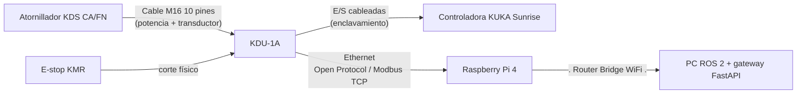

# Atornillador KMR iiwa: elección de hardware y arquitectura de control

Documento de decisiones para el atornillado autónomo con el IIWA14 sobre la plataforma KMR, controlado desde ROS 2 con el PC principal **fuera** de la plataforma.

---

## 1. Atornillador y controladora

| Componente | Modelo elegido | Motivo |
|---|---|---|
| Atornillador | **Kolver KDS-PL..CA/FN** (K-DUCER, carcasa de aluminio con brida y husillo telescópico) | Transductor de par integrado: mide el par real, no la corriente. Control de par + ángulo. Formato con brida pensado para montaje en robot/máquina. |
| Controladora | **Kolver KDU-1A** | Modbus TCP y Open Protocol por Ethernet integrados. 200 programas, 24 secuencias, E/S digitales (20 IN / 21 OUT), gráfica de par en tiempo real. |

**COMPROBAR PESO PARA DISEÑO DE BRIDA PROPIA EN TCP**

**Alternativas evaluadas:** Atlas Copco MicroTorque QMC/QMT + MTF6000, DOGA MD + MDC V2 y FIAM MCA (módulo para cobot).
Descartadas por encontrar más facilidad en la conexión de la KDU-1A, se pueden volver a evaluar atendiendo necesidades.

---

## 2. Hardware Embebido: Raspberry Pi 4 + bridge WiFi propio

| Elemento | Función |
|---|---|
| **Raspberry Pi 4** + SSD por USB | Nodo local de atornillado (ROS 2), cliente único de la KDU, almacenamiento del histórico y API de consulta. |
| **Router en modo cliente-puente (capa 2)** dentro del armario de la plataforma | Salida WiFi propia hacia la red del laboratorio, independiente de la AP de KUKA. |
| **Switch** (carril DIN, 24 V) | Conexión cableada a bordo de los equipos añadidos. |

**Por qué un bridge propio:** el WLAN Access Point 1010 de la KMR trabaja con NAT. El port forwarding sirve para TCP/SSH, pero ROS 2 sobre DDS no atraviesa bien el NAT (descubrimiento por multicast, puertos UDP dinámicos). 
No es tampoco recomendable usar el WiFi propio de la Raspberry Pi debido a posibles vulneraciones de seguridad.

**Requisitos del bridge**
- Modo **cliente-puente / WDS**, no router con NAT (Caeriamos en el mismo problema que con el AccessPoint1010).
- Canal distinto al de la AP de KUKA (idealmente 5 GHz) para evitar interferencias.

**Alimentación:** la KDU va con el inversor de 600 W que ya trae la plataforma. La Raspberry, el router y el switch, con convertidores DC-DC desde la batería. 
Embeber todo dentro de un mismo cuadro para facilidad de mantenimiento y modificaciones

---

## 3. Conexionado



1. **Atornillador → KDU-1A:** cable M16 de 10 pines (2,5 / 5 / 7 m). Lleva el motor y la señal del transductor. Hay que planificar el recorrido por el brazo para no limitar las articulaciones.
2. **KDU-1A ↔ Sunrise (E/S cableadas, solo enclavamiento):**
   - KDU → Sunrise: "herramienta en marcha". El robot no se mueve mientras gira el husillo.
   - Sunrise → KDU: "brazo en posición / habilitado". La KDU no arranca si el robot no lo permite.
   - No hay comunicación TCP entre Sunrise y la KDU: **un único maestro (la Raspberry)**.
1. **KDU-1A ↔ Raspberry (Ethernet):** la Raspberry es el único cliente de red de la KDU. *Propuesta:* KDU en una subred privada, para que nadie desde la red del laboratorio pueda mandarle órdenes sin pasar por ROS.
No es posible una conexión directa entre ellas debido a la necesidad de conectar la RPi al router para el Bridge WiFi
2. **Raspberry → bridge → gateway ROS (WiFi):** tráfico ROS 2 (action y topics) y API HTTP del histórico.

---

## 4. Interfaces ROS 2

### Action `/kmr_iiwa/screwdriver/tighten`
Atornillar es un action server: es una tarea larga, con feedback y cancelable.

| Parte | Contenido |
|---|---|
| **Goal** | `program_id` (programa/secuencia de la KDU), `screw_id` (trazabilidad), `target_torque` opcional validado contra los límites. *Se afinará al tener la KDU: programas predefinidos vs. datos sueltos.* |
| **Feedback** | Par, ángulo y velocidad actuales (si la KDU los entrega en tiempo real). |
| **Result** | `OK` / `NOK` / `ERROR`, par final, ángulo final, código de error KDU, timestamp. |

### Topic `/kmr_iiwa/screwdriver/status`
Estado **de la herramienta**, publicado a frecuencia fija. Hace de **heartbeat** para el watchdog de la gateway.
Valores: `DISCONNECTED`, `IDLE`, `READY`, `RUNNING`, `ERROR`.

### Topic `/kmr_iiwa/screwdriver/curve` 
Al terminar un atornillado la KDU devuelve la curva de atornillado, se obtiene la imagen de puntos por este topic y se muestra en el dashboard para un soporte visual.

---

## 5. Histórico de atornillados

- **Dónde:** en la Raspberry, sobre **SSD por USB**. Es la copia a largo plazo. El servidor ROS solo guarda la sesión actual.
- **Formato:** CSV con un fichero por día. Un registro por tornillo: timestamp, `screw_id`, `program_id`, resultado, par final, ángulo final, código de error. Las curvas, si las hay, en ficheros aparte, se debera enlazar dichas curvas con los `screw_id` para el seguimiento.
-**Recomendación de seguridad:** Volcado forzado tras cada tornillo para asegurarse de no corromper datos en caso de perdida de conexión o caida de tension.
- **Hora:** sincronizada con chrony contra el PC de ROS, para que los timestamps coincidan con los de ROS.
- **Acceso:** API HTTP ligera en la Raspberry (filtros por fecha o `screw_id`, paginación). **La llama la gateway, no el navegador:**

```
Navegador → nginx → gateway FastAPI → API Raspberry → CSV en SSD
```

Así nginx sigue siendo la única entrada, la Raspberry no queda expuesta y los roles del dashboard se aplican también al histórico. Leer el histórico no pasa por ROS y no lo carga.

- **Copia de seguridad:** exportación periódica o bajo demanda desde la gateway, para que la Raspberry no sea la única copia.

---

## 6. Pendientes

- [ ] Elegir el modelo KDS según el par y el tamaño de tornillo.
- [ ] Comprobar que el consumo de la KDU cabe en el inversor de 600 W junto con lo que ya alimenta.
- [ ] Diseñar la brida IIWA14 ↔ KDS y comprobar carga útil y par de reacción.
